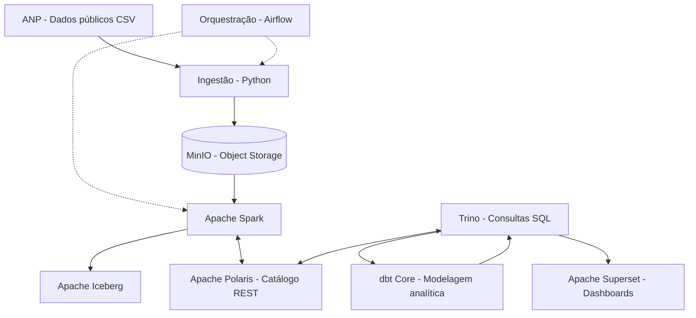

# Visão Geral da Arquitetura

## 1. Objetivo

Implementar uma plataforma analítica baseada em tecnologias
open source, utilizando dados públicos de preços de combustíveis
disponibilizados pela Agência Nacional do Petróleo (ANP).

A arquitetura deverá contemplar ingestão, armazenamento,
processamento, catálogo de metadados, consultas analíticas
e visualização de dados.

## 2. Arquitetura proposta

O diagrama representa a arquitetura planejada. A integração
entre os componentes será validada durante a implementação.

## 3. Responsabilidade dos componentes

| Componente | Responsabilidade |
|---|---|
| Python | Obter os arquivos da fonte e registrar metadados da ingestão |
| Apache Airflow | Orquestrar tarefas, dependências e novas tentativas |
| MinIO | Armazenar os arquivos originais e os dados processados |
| Apache Spark | Processar e transformar os dados |
| Apache Iceberg | Gerenciar tabelas analíticas sobre arquivos no object storage |
| Apache Polaris | Disponibilizar o catálogo Iceberg por meio de uma API REST |
| Trino | Executar consultas SQL sobre as tabelas |
| dbt Core | Organizar transformações SQL e testes dos modelos analíticos |
| Apache Superset | Disponibilizar dashboards e exploração dos dados |

## 4. Organização das camadas

### Bronze

Preservação dos arquivos originais e dos metadados da ingestão.

### Silver

Dados padronizados, tipados e submetidos a validações de qualidade.

### Gold

Modelos analíticos preparados para consultas e visualizações.

A implementação deverá definir explicitamente quais tabelas
serão gerenciadas pelo Apache Iceberg em cada camada.

## 5. Protocolos de comunicação

| Origem | Destino | Protocolo ou interface |
|---|---|---|
| Python | ANP | HTTPS |
| Python | MinIO | API compatível com S3 |
| Spark | MinIO | API compatível com S3 |
| Spark | Polaris | API REST do catálogo Iceberg |
| Trino | Polaris | API REST do catálogo Iceberg |
| Trino | MinIO | Acesso aos objetos no armazenamento |
| dbt | Trino | Conexão SQL via adaptador Trino |
| Superset | Trino | Conexão SQL via driver compatível |

Os protocolos e as configurações específicas serão confirmados
nos testes de integração de cada componente.

## 6. Decisões e trade-offs

As escolhas de tecnologias, as alternativas consideradas
e seus respectivos trade-offs serão documentados em ADRs
(Architecture Decision Records).

## 7. Status da implementação

**Status:** Planejada.

Nenhum componente desta arquitetura deve ser considerado
implementado ou validado apenas por estar descrito neste documento.
